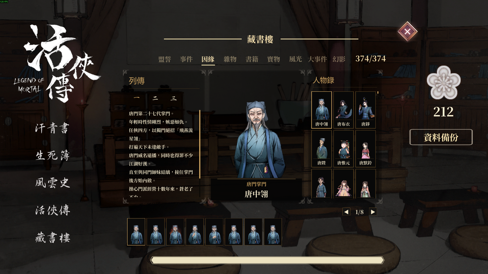
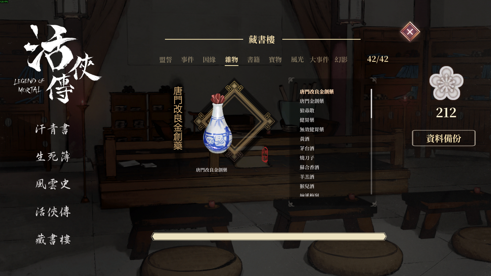
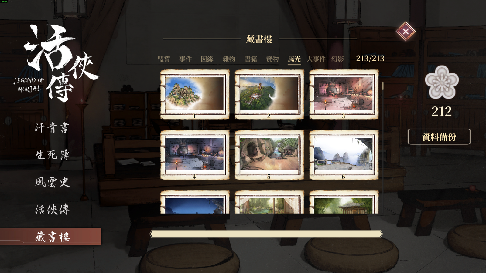
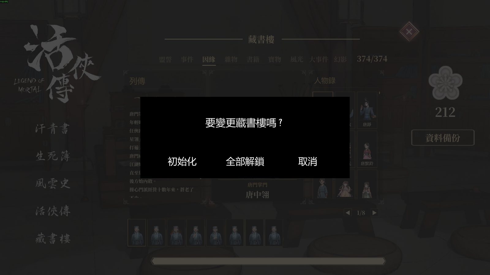
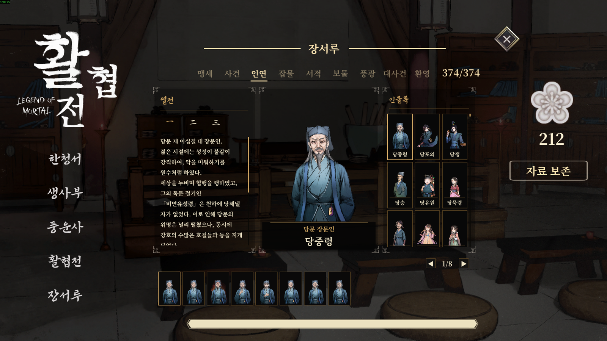
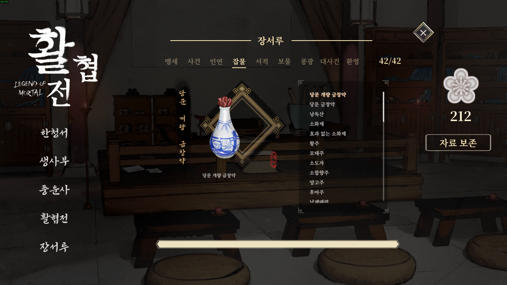
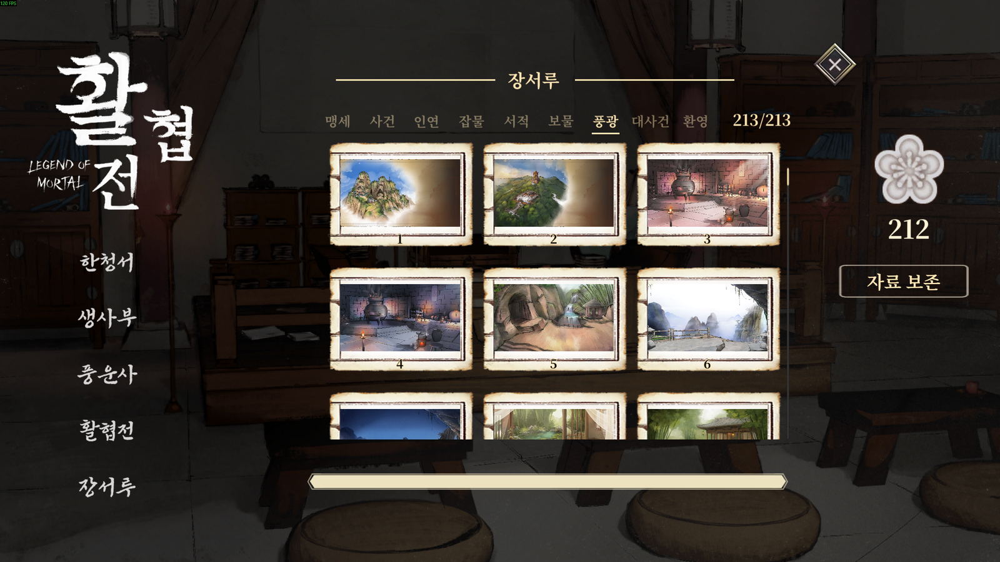
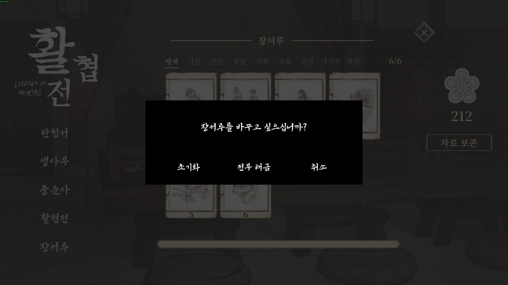

<div align="center">

# 藏書樓 · 장서루 · Jangseoru

**活俠傳 (Legend of Mortal) 圖鑑 MOD · 활협전 도감 모드**


-2E7D32?style=flat-square)


🌐 **Language / 語言 / 언어** — 아래에서 펼치세요 · 請展開下方語言

</div>

<details open>
<summary><b>🇹🇼 繁體中文</b></summary>

## 簡介

**藏書樓** 在遊戲的圖鑑畫面中加入一個「藏書樓」分頁，把你在遊戲裡**實際看過**的內容整理成收藏冊。

| 分頁 | 內容 |
|---|---|
| 誓約 | 結局誓約卡片 |
| 事件 | 事件圖畫 |
| 因緣 | 人物、列傳（一～四）、各人物看過的立繪 |
| 雜物 / 書籍 / 寶物 | 取得過的道具與說明 |
| 風光 / 大事件 / 幻影 | 背景、大幅圖畫、影片（整頁開啟，影片靜音循環） |

- **只收錄看過的內容**：沒看過的項目顯示為 `?` / `???`，不會提前劇透。
- 介面支援 **한국어 / 繁體中文 / 简体中文**，依遊戲語言自動切換。
- 新的事件圖、背景、大圖、影片會自動納入收藏冊（遊戲更新後不需要改 MOD）。

### 截圖

<p align="center"><br><sub>因緣：列傳、立繪、人物錄</sub></p>

<p align="center"><br><sub>雜物・書籍・寶物</sub></p>

<p align="center"><br><sub>風光・大事件・幻影</sub></p>

<p align="center"><br><sub>管理視窗 (F11)</sub></p>

### 安裝

1. 先安裝 **BepInEx 6.0.0-be.692 (Unity Mono)** 到遊戲資料夾。
2. 將 `Jangseoru.Plugin.dll` 與 `Jangseoru.Core.dll` **兩個檔案一起**放入
   `LegendOfMortal\BepInEx\plugins\Jangseoru\`。
3. 啟動遊戲，在圖鑑畫面開啟「藏書樓」。

解除安裝：刪除上述資料夾即可。遊戲與存檔不受影響。

### 管理視窗 (F11)

藏書樓開啟時按 **F11**，可以「重置」或「全部解鎖」。兩者都會再確認一次，並先把紀錄備份到
`JangseoruMod\backup\<時間>\`。Esc 取消。結局誓約的開啟狀態只記錄在 MOD 自己的檔案，不會改動遊戲的結局紀錄。

### 資料位置

`C:\Users\<使用者>\AppData\LocalLow\Obb Studio\JangseoruMod\`
（`byeolho.txt`、`gallery.txt`、`inyeon.txt`、`items.txt`、`media.txt`、`oath.txt`）。
這些檔案位於遊戲存檔資料夾之外，可以保留或刪除。

### 安全原則

- 只使用 Harmony **Postfix**；所有掛鉤與介面都包在 try/catch 內，出錯時只會關閉自己的功能。
- 遊戲的資料、存檔、其他 MOD 一律不修改；遊戲給的圖片與字型只讀取，不修改也不銷毀。
- 無法讀取的紀錄檔不會被覆寫；遊戲版本改變導致介面對不上時，只有受影響的功能會被關閉。

### 相容性

在遊戲 `1.0.6001.0`（以及 `1.0.6000.5`）、BepInEx `6.0.0-be.692` 上驗證：所有掛鉤皆成功套用，自我檢查無警告。
`1.0.6001.0` 重新製作了回想（Log）功能；本 MOD 不使用回想相關的類別，因此不受影響。
與其他 MOD 同時使用尚未驗證，歡迎回報。

### 使用的技術

| 項目 | 說明 |
|---|---|
| C# 12 | 全部程式碼 |
| `Jangseoru.Core` (netstandard2.0) | 與遊戲無關的純邏輯（檔案讀寫、收藏冊資料、事件順序） |
| `Jangseoru.Plugin` (net472) | BepInEx 外掛層：透過反射讀取遊戲、Postfix 掛鉤、介面 |
| Unity 2020.3 (Mono) / Unity UI | 遊戲引擎；介面以程式動態建立 |
| BepInEx 6 / HarmonyX | 外掛載入與方法掛鉤 |
| xUnit (.NET 8) | 單元測試與遊戲介面契約測試 |
| PowerShell | 打包與測試環境腳本 |

### 建置

```powershell
powershell -NoProfile -File tools/fetch-refs.ps1      # 取得 BepInEx/HarmonyX 參考 DLL 到 libs/
dotnet build Jangseoru.sln -c Release
dotnet test tests/Jangseoru.Core.Tests -c Release
powershell -NoProfile -File tools/package.ps1         # dist/Jangseoru/：只有兩個 DLL
```

遊戲的 `Mortal_Data/Managed` 只當作編譯參考，不會被複製或散佈（預設 `../LegendOfMortal`，可用 `-p:GameDir=...` 指定）。
本倉庫**不含**遊戲圖片與資料；`Resources/` 中只有兩張紙張外框。缺少的圖片在遊戲中會以簡單的替代圖樣顯示，
因人物清單檔不在倉庫內，從原始碼自行建置的版本「因緣」分頁會是空的。

</details>

<details>
<summary><b>🇰🇷 한국어</b></summary>

## 소개

**장서루**는 게임 도감 화면에 "장서루" 탭을 추가해, 게임에서 **실제로 본 것**을 수집첩으로 모아 보여 주는 모드입니다.

| 탭 | 내용 |
|---|---|
| 맹세 | 엔딩 맹세 카드 |
| 사건 | 사건 그림 |
| 인연 | 인물, 열전(一~四), 인물별로 본 그림 |
| 잡물 / 서적 / 보물 | 얻은 아이템과 설명 |
| 풍광 / 대사건 / 환영 | 배경, 큰 그림, 영상(전체 화면, 영상은 음소거 반복) |

- **본 것만 열립니다**: 아직 못 본 항목은 `?` / `???`로 가려 미리 알려 주지 않습니다.
- 화면은 **한국어 / 繁體中文 / 简体中文**을 지원하며 게임 언어에 따라 자동으로 바뀝니다.
- 새 사건 그림·배경·큰 그림·영상은 도감에 자동으로 반영됩니다(게임 업데이트 때마다 모드를 고칠 필요가 없습니다).

### 스크린샷

<p align="center"><br><sub>인연: 열전, 그림, 인물록</sub></p>

<p align="center"><br><sub>잡물·서적·보물</sub></p>

<p align="center"><br><sub>풍광·대사건·환영</sub></p>

<p align="center"><br><sub>관리 창 (F11)</sub></p>

### 설치

1. 게임 폴더에 **BepInEx 6.0.0-be.692 (Unity Mono)**를 먼저 설치합니다.
2. `Jangseoru.Plugin.dll`과 `Jangseoru.Core.dll` **두 파일을 함께**
   `LegendOfMortal\BepInEx\plugins\Jangseoru\`에 넣습니다.
3. 게임을 켜고 도감 화면에서 "장서루"를 엽니다.

제거: 위 폴더를 지우면 됩니다. 게임과 세이브에는 영향이 없습니다.

### 관리 창 (F11)

장서루가 열려 있을 때 **F11**을 누르면 "초기화" 또는 "전부 해금"을 고를 수 있습니다. 둘 다 한 번 더 확인하며,
실행 전에 기록을 `JangseoruMod\backup\<시각>\`에 백업합니다. Esc로 취소합니다. 맹세의 열림 상태는 모드 전용 파일에만 기록하고
게임의 엔딩 기록은 건드리지 않습니다.

### 데이터 위치

`C:\Users\<사용자>\AppData\LocalLow\Obb Studio\JangseoruMod\`
(`byeolho.txt`, `gallery.txt`, `inyeon.txt`, `items.txt`, `media.txt`, `oath.txt`).
게임 세이브 폴더 밖에 있으며, 남겨 두어도 지워도 됩니다.

### 안전 원칙

- Harmony **Postfix**만 사용합니다. 모든 훅과 UI는 try/catch로 감싸, 문제가 생기면 자기 기능만 꺼집니다.
- 게임 데이터·세이브·다른 모드는 수정하지 않습니다. 게임이 준 그림과 폰트는 읽기만 하고 수정·파괴하지 않습니다.
- 읽을 수 없는 기록 파일은 덮어쓰지 않습니다. 게임 버전이 바뀌어 맞지 않으면 해당 기능만 꺼집니다.

### 호환성

게임 `1.0.6001.0`(및 `1.0.6000.5`), BepInEx `6.0.0-be.692`에서 확인했습니다. 모든 훅이 정상 적용되고 자체 점검에 경고가 없습니다.
`1.0.6001.0`에서 회상(Log) 기능이 새로 만들어졌는데, 이 모드는 회상 관련 클래스를 사용하지 않아 영향이 없습니다.
다른 모드와의 동시 사용은 아직 확인하지 못했습니다. 제보를 환영합니다.

### 사용 기술

| 항목 | 설명 |
|---|---|
| C# 12 | 모든 코드 |
| `Jangseoru.Core` (netstandard2.0) | 게임과 무관한 순수 로직(파일 입출력, 수집 데이터, 이벤트 순서) |
| `Jangseoru.Plugin` (net472) | BepInEx 플러그인 층: 리플렉션으로 게임 읽기, Postfix 훅, UI |
| Unity 2020.3 (Mono) / Unity UI | 게임 엔진. UI는 코드로 만듭니다 |
| BepInEx 6 / HarmonyX | 플러그인 로딩과 메서드 훅 |
| xUnit (.NET 8) | 단위 테스트와 게임 계약 테스트 |
| PowerShell | 패키징·테스트 환경 스크립트 |

### 빌드

```powershell
powershell -NoProfile -File tools/fetch-refs.ps1      # BepInEx/HarmonyX 참조 DLL을 libs/에 준비
dotnet build Jangseoru.sln -c Release
dotnet test tests/Jangseoru.Core.Tests -c Release
powershell -NoProfile -File tools/package.ps1         # dist/Jangseoru/: DLL 두 개만
```

게임의 `Mortal_Data/Managed`는 컴파일 참조로만 읽고 복사·배포하지 않습니다(기본 `../LegendOfMortal`, `-p:GameDir=...`로 지정).
이 저장소에는 게임의 그림과 데이터가 **들어 있지 않습니다**. `Resources/`에는 종이 틀 두 장만 있고, 없는 그림은 게임에서
단순한 대체 모양으로 나옵니다. 인물 목록 파일이 저장소에 없으므로, 소스에서 직접 빌드한 DLL은 "인연" 탭이 비어 있습니다.

</details>

---

<sub>This is an unofficial fan-made mod and is not affiliated with the developers or publisher of 活俠傳 / Legend of Mortal. All game assets belong to their owners. · 非官方同人 MOD，與遊戲開發商、發行商無關。遊戲素材版權屬於原權利人。 · 비공식 팬 모드이며 게임 개발사·유통사와 무관합니다.</sub>
